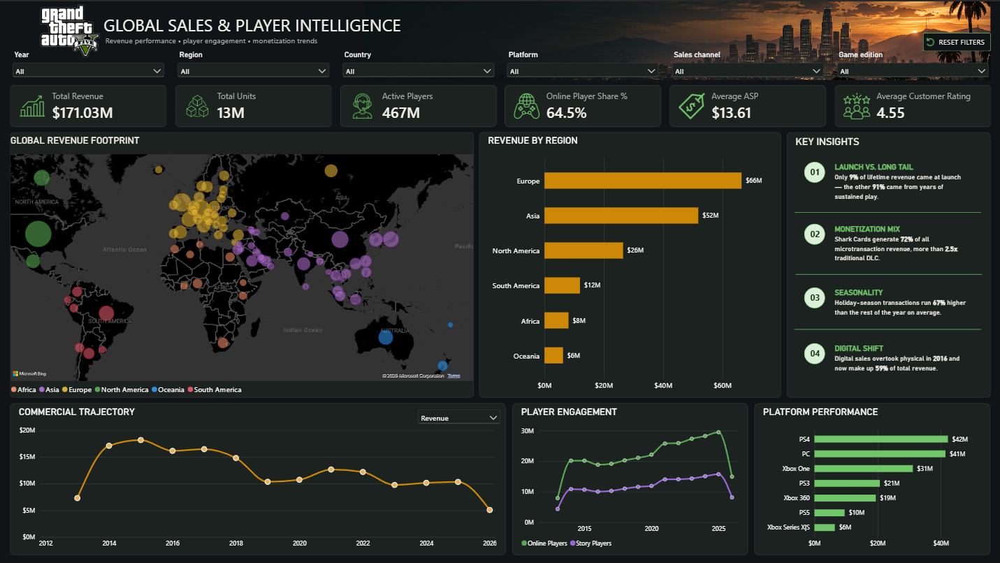

# GTA V Global Sales & Player Intelligence Dashboard

An interactive Power BI dashboard exploring the global sales performance, revenue trends, and player engagement of Grand Theft Auto V.

## Dashboard Preview

## Project Overview

This project analyzes GTA V's sales and player analytics data to explore revenue performance over time, regional sales distribution, monetization patterns, and player engagement.

The dashboard brings these metrics together in a single interactive report, allowing users to explore trends and compare performance across years, regions, platforms, and sales channels.

## Key Insights

- **Long-term Revenue:** Only 9% of lifetime revenue came from launch, while the remaining 91% was generated over subsequent years.
- **Monetization:** Shark Cards represent a major contributor to microtransaction revenue.
- **Seasonality:** Seasonal transaction patterns reveal differences in activity throughout the year.
- **Digital Transformation:** Digital sales overtook physical sales in 2016 and now account for 59% of total revenue.

## Dashboard Features

- KPI cards highlighting revenue, units sold, player activity, average selling price, and customer ratings.
- Geographic visualization of revenue across global markets.
- Regional revenue comparisons.
- Dynamic metric selector for exploring revenue, units, and player trends over time.
- Player engagement and platform performance analysis.
- Interactive slicers for filtering the report.

## Tools & Skills

- **Power BI Desktop** — dashboard development and data visualization
- **DAX** — measures and time-based calculations
- **Data Analysis** — trend analysis and performance comparisons
- **Dashboard Design** — interactive reporting and visual storytelling

## Dataset

Source: [GTA V Worldwide Sales and Player Analytics — Kaggle](https://www.kaggle.com/datasets/crystalbaby/gta-v-worldwide-sales-and-player-analytics)

The analysis and findings presented here are based on this dataset.

## Project Purpose

This is my first Power BI dashboard project and part of my journey into data analytics. It gave me an opportunity to practise building interactive reports, working with DAX measures, and presenting data-driven findings in a clear visual format.

I'm continuing to learn and improve my analytical and visualization skills.

---

**Feedback and suggestions are welcome!**
